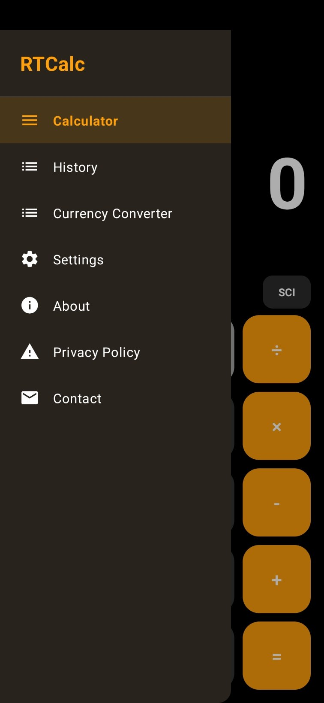
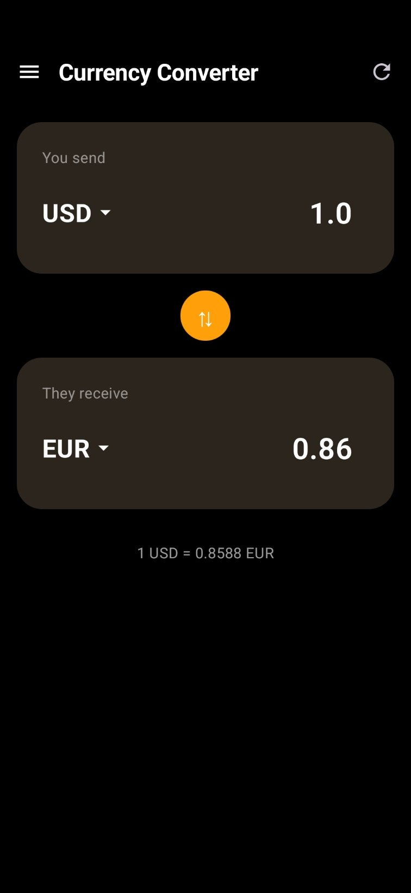
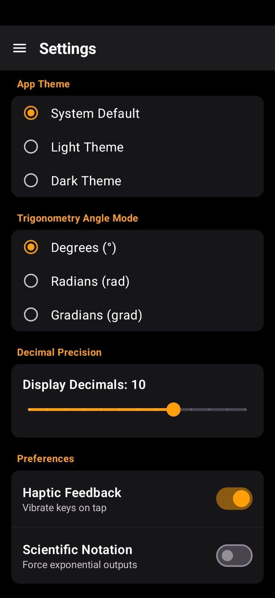

# RTCalc

[](https://android.com)
[](https://kotlinlang.org)
[](https://developer.android.com/jetpack/compose)
[](https://developer.android.com/topic/architecture)
[](LICENSE)

A clean scientific calculator and currency converter for Android built with Kotlin and Jetpack Compose.

---

## Screenshots

<p align="center">
  
  
  
  
  
</p>

---

## Features

- **Standard & Scientific Math**: BODMAS order of operations, trigonometry (sin, cos, tan, inverse, hyperbolic), logarithms (log, ln, log2), combinations (nCr), permutations (nPr), factorial, powers, roots, and angle modes (DEG / RAD).
- **Interactive Cursor & Undo/Redo**: Full cursor positioning, text selection, and undo/redo history for uninterrupted editing.
- **Currency Converter**: Real-time exchange rate updates with offline room caching and built-in support for global currencies, including NPR.
- **Local Calculation History**: Persistent storage powered by Room with instant search and one-tap expression restoration.
- **Adaptive Theming & Haptics**: Dark, Light, and System theme synchronisation paired with tactile mechanical key feedback.
- **Responsive Layout**: Adapts cleanly across compact phones, foldables, and tablets with side-by-side history panels.

---

## Tech Stack & Architecture

- **UI**: Jetpack Compose, Material 3 design tokens
- **Architecture**: Clean Architecture / MVVM with reactive StateFlows
- **Dependency Injection**: Dagger Hilt
- **Database**: Room for calculation history and cached exchange rates
- **Networking**: Retrofit 2 + OkHttp with Kotlinx Serialization
- **Settings**: Jetpack DataStore Preferences

```
app/src/main/java/com/ritikthakur/rtcalc/
├── data/
│   ├── local/          # Room DB, DAOs, and entities (History, Currency)
│   ├── remote/         # Retrofit API interface & response models
│   └── repository/     # Data repositories & DataStore settings
├── di/                 # Hilt dependency injection modules
├── domain/             # Expression evaluator & math parsing engine
├── ui/
│   ├── theme/          # Typography, colors, and Material 3 themes
│   ├── view/           # Compose screens, keypads, and navigation
│   └── viewmodel/      # Calculator and Currency ViewModels
└── util/               # Haptic feedback and utility helpers
```

---

## Getting Started

### Prerequisites
- Android Studio Hedgehog (2023.1.1) or newer
- JDK 17
- Android SDK with API 34 build-tools
- Android device or emulator running Android 8.0 (API 26) or higher

### Build & Run

1. Clone the repository:
   ```bash
   git clone https://github.com/ritikthakur22/RTCalc.git
   cd RTCalc
   ```

2. Open the project in Android Studio and sync Gradle.

3. To assemble the debug APK:
   ```bash
   ./gradlew assembleDebug
   ```

4. To assemble the release APK:
   ```bash
   ./gradlew assembleRelease
   ```

5. Run unit tests:
   ```bash
   ./gradlew test
   ```

---

## License

This project is licensed under the [MIT License](LICENSE).
