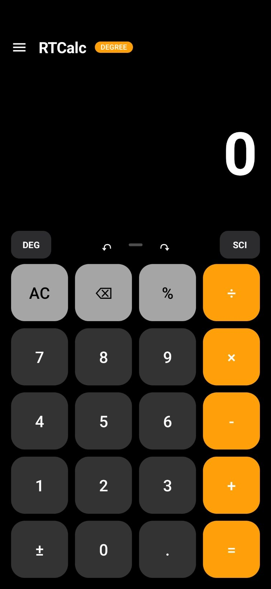

<div align="center">

  

  # RTCalc

  **A modern, high-precision scientific calculator and real-time currency converter for Android.**

  [-3DDC84?style=for-the-badge&logo=android&logoColor=white)](https://android.com)
  [](https://kotlinlang.org)
  [](https://developer.android.com/jetpack/compose)
  [](LICENSE)
  [](https://github.com/ritikthakur22/RTCalc/releases)

</div>

---

## Overview

**RTCalc** is a lightweight, responsive Android calculator combining an everyday standard keypad, an expandable scientific math engine, and an offline-capable live currency exchange converter. Built with Kotlin, Jetpack Compose, Material 3, Room, and Dagger Hilt following modern Clean Architecture principles.

---

## Screenshots

<div align="center">
  <table>
    <thead>
      <tr>
        <th align="center">Standard Keypad</th>
        <th align="center">Scientific Mode</th>
        <th align="center">Currency Converter</th>
        <th align="center">Searchable History</th>
        <th align="center">Settings & Themes</th>
      </tr>
    </thead>
    <tbody>
      <tr>
        <td align="center"></td>
        <td align="center"></td>
        <td align="center"></td>
        <td align="center"></td>
        <td align="center"></td>
      </tr>
    </tbody>
  </table>
</div>

---

## Key Features

### 🧮 1. Standard Arithmetic & Precision Engine
- **Algebraic Order of Operations**: Full BODMAS/PEMDAS precedence evaluation with parentheses support.
- **Floating-Point Accuracy**: Precision handling preventing common IEEE 754 decimal rounding inaccuracies (e.g., `0.1 + 0.2 = 0.3`).
- **Interactive Cursor & Undo/Redo**: Tap anywhere inside long mathematical expressions to place the cursor, select text, or step back through complete undo and redo stacks.
- **Dynamic Text Scaling**: Long digits auto-scale smoothly to avoid wrapping or truncation.

### 🔬 2. Advanced Scientific Mathematics
- **Trigonometry**: Sine, Cosine, Tangent, and their Inverse (`asin`, `acos`, `atan`) & Hyperbolic (`sinh`, `cosh`, `tanh`) forms.
- **Angle Units**: One-tap toggle between Degrees (DEG) and Radians (RAD).
- **Logarithms & Powers**: Common logarithm (`log₁₀`), Natural log (`ln`), Binary log (`log₂`), exponentiation (`xʸ`, `eˣ`, `10ˣ`), and square/cubic roots.
- **Combinatorics**: Permutations (`nPr`), Combinations (`nCr`), Factorials (`x!`), Modulo, and GCD/LCM functions.
- **Mathematical Constants**: Built-in high-precision values for Pi ($\pi$), Euler's Number ($e$), and the Golden Ratio ($\phi$).

### 💱 3. Real-Time Currency Converter
- **Global Exchange Rates**: Live rate synchronization via REST API with fallback to local SQLite cache.
- **Nepali Rupee (NPR) Support**: Full first-class support for NPR alongside major world currencies (USD, EUR, GBP, JPY, INR, CAD, AUD, etc.).
- **Offline First**: Automatic 1-hour cache lifetime managed through Room, allowing uninterrupted conversions without internet access.
- **Instant Swapping**: Reverse source and target currencies with one tap.

### 📜 4. Persistent Calculation History
- **Local Room Database**: Encrypted local storage tracking past equations and computed results.
- **Real-Time Search Filter**: Instantly locate previous computations by typing numbers or operators into the search bar.
- **One-Tap Restore**: Tap any historical item to load the expression or result back into the active display.

### 🎨 5. Ergonomics & Theming
- **AMOLED Dark & Clean Light Themes**: Pure obsidian dark mode for battery savings on OLED screens, alongside crisp light and system-matching modes.
- **Tactile Haptic Feedback**: Optional key vibration replicating the feel of physical mechanical calculator keys.
- **Adaptive Layout**: Side-by-side split panels on tablets/foldables and intuitive slide-out navigation on phones.

---

## Architecture & Tech Stack

RTCalc is built following Google's official Android app architecture recommendations:

```
┌────────────────────────────────────────────────────────┐
│                      UI Layer                          │
│     Jetpack Compose + Material 3 + Navigation Drawer   │
└───────────────────────────▲────────────────────────────┘
                            │ StateFlow / Events
┌───────────────────────────┴────────────────────────────┐
│                   ViewModel Layer                      │
│        CalculatorViewModel    CurrencyViewModel        │
└───────────────────────────▲────────────────────────────┘
                            │ Domain Calls / Repositories
┌───────────────────────────┴────────────────────────────┐
│                 Domain & Data Layer                    │
│   ExpressionEvaluator (Math Parser)                    │
│   HistoryRepository      CurrencyRepository            │
│   Room Database (SQLite) Retrofit API (REST JSON)      │
└────────────────────────────────────────────────────────┘
```

### Libraries & Tools
- **UI Toolkit**: [Jetpack Compose](https://developer.android.com/jetpack/compose) with [Material 3](https://m3.material.io/)
- **Architecture**: MVVM with Kotlin Coroutines & `StateFlow`
- **Dependency Injection**: [Dagger Hilt](https://dagger.dev/hilt/)
- **Local Persistence**: [Room](https://developer.android.com/training/data-storage/room) & [DataStore Preferences](https://developer.android.com/topic/libraries/architecture/datastore)
- **Networking**: [Retrofit 2](https://square.github.io/retrofit/) + [OkHttp 4](https://square.github.io/okhttp/) + Kotlinx Serialization
- **Unit Testing**: JUnit 4, Mockito, Robolectric, Kotlinx Coroutines Test

---

## Project Structure

```
RTCalc/
├── app/
│   ├── src/
│   │   ├── main/
│   │   │   ├── java/com/ritikthakur/rtcalc/
│   │   │   │   ├── data/
│   │   │   │   │   ├── local/          # Room database, entities & DAOs
│   │   │   │   │   ├── remote/         # Retrofit API interface & models
│   │   │   │   │   └── repository/     # History, Currency & Settings repos
│   │   │   │   ├── di/                 # Hilt dependency injection modules
│   │   │   │   ├── domain/             # Expression evaluator & tokenizer
│   │   │   │   ├── ui/
│   │   │   │   │   ├── theme/          # Color schemes, shapes & typography
│   │   │   │   │   ├── view/           # Keypads, displays & screens
│   │   │   │   │   └── viewmodel/      # Calculator & Currency ViewModels
│   │   │   │   └── util/               # Haptic manager & utility helpers
│   │   │   └── res/                    # Vector icons, mipmaps & strings
│   │   └── test/                       # Unit tests (math engine & ViewModels)
│   └── build.gradle.kts                # App module build configuration
├── docs/
│   └── play_store_assets.md            # Google Play Store listing metadata
├── Screenshots/                        # High-resolution showcase assets
├── logo.svg                            # App vector brand mark
└── README.md
```

---

## Getting Started

### Prerequisites
- **Android Studio**: Hedgehog (2023.1.1) or higher
- **JDK**: Version 17
- **Android SDK**: API 34 build-tools
- **Minimum Target**: Android 8.0 (API level 26)

### Build Instructions

1. **Clone the repository:**
   ```bash
   git clone https://github.com/ritikthakur22/RTCalc.git
   cd RTCalc
   ```

2. **Open in Android Studio:**
   Select **File > Open** and point to the `RTCalc` root folder. Allow Gradle to download dependencies and sync.

3. **Run Unit Tests:**
   ```bash
   ./gradlew test
   ```

4. **Build Debug APK:**
   ```bash
   ./gradlew assembleDebug
   ```
   *Output: `app/build/outputs/apk/debug/app-debug.apk`*

5. **Build Release APK:**
   ```bash
   ./gradlew assembleRelease
   ```
   *Output: `app/build/outputs/apk/release/app-release.apk` (1.9 MB, R8 minified & signed)*

---

## Google Play Store Assets

All store listing descriptions, promotional bullets, privacy policy disclosures, and keyword tags are documented in:
👉 [docs/play_store_assets.md](docs/play_store_assets.md)

---

## License

This project is licensed under the **MIT License**. See the [LICENSE](LICENSE) file for details.

---

<div align="center">
  <sub>Built with ❤️ by <a href="https://github.com/ritikthakur22">Ritik Thakur</a></sub>
</div>
